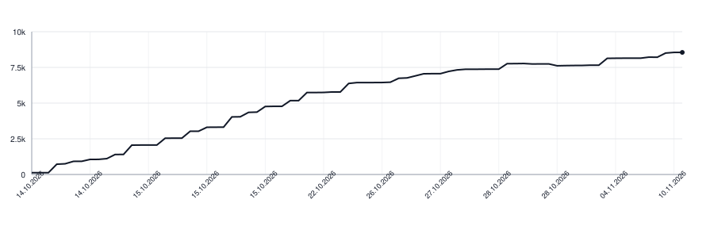

# diskcleaner

[](https://github.com/botforge-pro/diskcleaner/actions/workflows/ci.yml)

Frees disk space on a developer's Mac: build output, caches and leftovers that
the tools make again. Steps whose deletions cannot be undone are off until you
turn them on; the last column below says what even the others can lose.

## Install

```sh
go install github.com/botforge-pro/diskcleaner@latest
```

It lands in `$(go env GOPATH)/bin` (usually `~/go/bin`), or in `GOBIN` when set;
that folder must be on your `PATH`.

## Use

```sh
diskcleaner clean --dry-run                        # what would go, nothing removed
diskcleaner clean                                  # remove it, say what is free
diskcleaner clean --only projects,go-cache         # just these steps
diskcleaner clean --projects.git-tmp-min-age=0     # any setting, for this run
diskcleaner config                                 # every setting and where it came from
```

`clean` keeps what is in use. A cache is emptied whole, but not while its tool
runs. In projects and temporary folders a path stays while a process holds it
open, when it was written within `min-age`, or when Git tracks a file in it.
When `lsof` or Git cannot answer, the path stays and the step fails. Each kept
path is listed as `SKIPPED` with the reason; `--report FILE` writes the totals.

`--only` and `--skip` choose among the steps that are on; a step that is off
runs only with `--<step>.enabled`, and `clean` lists it as `OFF`, with what it
would free under `--dry-run`. One `clean` runs at a time; its lock is
`~/.local/state/diskcleaner/lock` (or under `$XDG_STATE_HOME`).

| Exit | Means |
|---|---|
| 0 | done |
| 1 | done, some paths failed (`FAILED` lines) |
| 2 | nothing touched: a wrong setting or command |
| 3 | nothing touched: another `clean` runs; its PID and start are printed |
| 4 | done without failures, but less than `min-free` is free |

## Configure

Everything works without a config. To change a setting, put it in
`~/.config/diskcleaner.toml` (or `$XDG_CONFIG_HOME/diskcleaner.toml`, or
`--config FILE`), or pass it as `--key=value` for one run; a flag wins over the
file. The `DISKCLEANER_*` variables of 0.19 and before are not read: a run that
finds one stops and says what to write instead.

```toml
project-dirs = ["~/Developer", "~/work"]
min-age = "1h"
min-free = "5GB"

[xcode-archives]
enabled = true
min-age = "30d"
```

| Setting | Default | |
|---|---|---|
| `project-dirs` | those of `~/Developer`, `~/Projects`, `~/src`, `~/code`, `~/GolandProjects`, `~/IdeaProjects`, `~/AndroidStudioProjects` that exist | where Git repositories sit, one level down; `node_modules` is found at any depth |
| `min-age` | `1h` | in projects, temporary folders and app copies, anything written more recently stays |
| `min-free` | `0` (off) | exit 4 when less is free after `clean` |
| `<step>.enabled` | on, off for the steps marked below | |

A duration is like `90m`, `1h30m` or `15d`; a size like `500KB` or `5GB`, where
1KB is 1024 bytes; a folder starts with `/` or `~/`. Each step's own settings
are under it below.

## Steps

`clean` runs them in this order. **Off by default:** delete what cannot come back.

| Step | Removes | Keeps | Can lose |
|---|---|---|---|
| `projects` | in each project: `.build` of Swift packages, Gradle `build`, `.apk`/`.aab`, `node_modules` with a lockfile, temporary files of a dead `git fetch` or `git repack` (`git-tmp-min-age`, `1h`), Git LFS objects the remote has (`lfs-timeout`, `10m` per repository) | `node_modules` without a lockfile | packages installed with `--no-save`, unpublished, or from a registry you no longer reach |
| `gradle-caches` | `$GRADLE_USER_HOME/caches` | all while Gradle, Android Studio or IntelliJ run | |
| `docker-images` | images no container uses (`timeout`, `30s`; `prune-timeout`, `15m`) | volumes | an image neither a registry nor a Dockerfile still has |
| `go-cache` | the Go module and build caches | all while `go` builds | |
| `swiftpm-cache` | the SwiftPM package cache | all while Swift or Xcode build | |
| `xcode-derived-data` | Xcode DerivedData | all while Xcode builds; in a folder you picked in Xcode, what Xcode did not make | |
| `simulator-caches` | Core ML caches of shut-down simulators | app data | |
| `temp-leftovers` | work folders of killed Go builds, Xcode export leftovers | | |
| `code-sign-clones` | copies of Chrome and other apps no running app was started from | | |
| `claude-scratchpads` | build output in Claude Code scratchpads | the scratchpads | |
| **`homebrew`** | old versions of formulae and casks; every download, whatever its age (`timeout`, `15m`) | installed versions | the old versions |
| **`xcode-archives`** | archives older than `min-age` (`15d`) | the newest `keep` (`1`) of each app; any archive in a folder not named by a date | the signed builds and their debug symbols |
| **`ide-old-versions`** | settings, caches and logs of IDE versions older than the installed one | data of every installed version | settings the new version did not copy |
| **`simulator-data`** | apps and data of simulators idle for `idle` (`3d`); the simulator stays, as new | | their apps and data |
| **`system-temp`** | your files in `/private/tmp` larger than `min-size` (`1MB`) | sockets, mounted volumes, dot files, what a process holds open | whatever was kept there |
| **`claude-logs`** | Claude Code session logs older than `min-age` (`20d`) | open logs | resuming those sessions |
| **`codex-logs`** | Codex session logs older than `min-age` (`20d`) | open logs | resuming those sessions |

## Lines of Code

<picture>
  <source media="(prefers-color-scheme: dark)" srcset="https://raw.githubusercontent.com/botforge-pro/diskcleaner/main/.github/loc-history-dark.svg">
  <source media="(prefers-color-scheme: light)" srcset="https://raw.githubusercontent.com/botforge-pro/diskcleaner/main/.github/loc-history-light.svg">
  
</picture>
