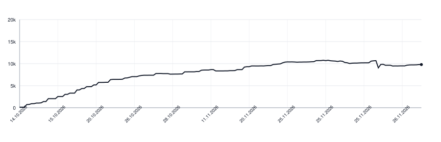

# diskcleaner

[](https://github.com/botforge-pro/diskcleaner/actions/workflows/ci.yml)

Frees disk space on a developer's Mac: build output, caches and leftovers that
the tools make again. Every step runs unless you turn it off; the steps in bold
below delete what cannot be undone, and the last column says what each can lose.

## Install

```sh
go install github.com/botforge-pro/diskcleaner@latest
```

It lands in `$(go env GOPATH)/bin` (usually `~/go/bin`), or in `GOBIN` when set;
that folder must be on your `PATH`.

## Use

```sh
diskcleaner clean --dry-run                        # what would go, nothing removed
diskcleaner clean                                  # remove it, say what is free
diskcleaner clean --only projects,go-cache         # just these steps
diskcleaner clean --projects.git-tmp-min-age=0     # any setting, for this run
diskcleaner config                                 # every setting and where it came from
```

`clean` checks for data in use before deleting it. A cache is emptied whole;
its step skips it when its process check detects the tool running. In projects
and temporary folders a path stays while a process holds it
open, when it was written within `min-age`, or when Git tracks a file in it.
`system-temp` ignores `min-age` and keeps what was used within 3 days, as macOS
does there.
When `lsof` or Git cannot answer, the path stays and the step fails. Each kept
path is listed as `SKIPPED` with the reason; `--report FILE` writes the totals.

`--only` and `--skip` choose among the steps that are on; a step turned off with
`--<step>.enabled=false` or in the config is listed as `OFF`, with what it would
free under `--dry-run`. One `clean` runs at a time; its lock is
`~/.local/state/diskcleaner/lock` (or under `$XDG_STATE_HOME`).

Go cache cleanup and builds:

- Before each Go cache deletion, `clean` checks for running Go commands again,
  after measuring the cache. A detected command or a failed process check
  keeps that cache.
- Go and diskcleaner do not share an atomic lock. A Go command starting after
  the last check or during deletion can still lose files it needs.
- Announce cleanup before starting it. From that announcement until `clean`
  finishes, everyone using the machine must defer new Go commands.

| Exit | Means |
|---|---|
| 0 | done |
| 1 | done, some paths failed (`FAILED` lines) |
| 2 | nothing touched: a wrong setting or command |
| 3 | nothing touched: another `clean` runs; its PID and start are printed |
| 4 | done without failures, but less than `min-free` is free |

## Configure

Everything works without a config. To change a setting, put it in
`~/.config/diskcleaner.toml` (or `$XDG_CONFIG_HOME/diskcleaner.toml`, or
`--config FILE`), or pass it as `--key=value` for one run; a flag wins over the
file. The `DISKCLEANER_*` variables of 0.19 and before are not read: a run that
finds one stops and says what to write instead.

```toml
project-dirs = ["~/Developer", "~/work"]
min-age = "1h"
min-free = "5GB"

[xcode-archives]
min-age = "30d"

[homebrew]
enabled = false
```

| Setting | Default | |
|---|---|---|
| `project-dirs` | those of `~/Developer`, `~/Projects`, `~/src`, `~/code`, `~/GolandProjects`, `~/IdeaProjects`, `~/AndroidStudioProjects` that exist | where Git repositories sit, one level down; `node_modules` is found at any depth |
| `min-age` | `1h` | in projects, temporary folders and app copies, anything written within it stays; `system-temp` keeps 3 days instead |
| `min-free` | `0` (off) | exit 4 when less is free after `clean` |
| `<step>.enabled` | on | |

A duration is like `90m`, `1h30m` or `15d`; an age of `0` keeps nothing for its
age. A size is like `500KB` or `5GB`, where 1KB is 1024 bytes; a folder starts
with `/` or `~/`. Each step's own settings are under it below.

## Steps

`clean` runs them in this order. **In bold:** delete what cannot come back.

| Step | Removes | Keeps | Can lose |
|---|---|---|---|
| `projects` | in each project: `.build` of Swift packages, Gradle `build`, `.apk`/`.aab`, Python's `__pycache__` anywhere outside `node_modules` and `.build`, `node_modules` with a lockfile, temporary files of a dead `git fetch` or `git repack` older than `projects.git-tmp-min-age` (`1h`), Git LFS objects the remote has, giving up on a repository after `projects.lfs-timeout` (`10m`) | `node_modules` without a lockfile | packages installed with `--no-save`, unpublished, or from a registry you no longer reach |
| `gradle-caches` | `$GRADLE_USER_HOME/caches` | all while Gradle, Android Studio or IntelliJ run |  |
| `docker-images` | images no container uses, giving up on a Docker that does not answer after `docker-images.timeout` (`30s`) and on a prune after `docker-images.prune-timeout` (`15m`) | volumes | an image neither a registry nor a Dockerfile still has |
| `go-cache` | the Go module and build caches | each cache when a Go command is detected before deletion |  |
| **`homebrew`** | old versions of formulae and casks; every download, whatever its age, giving up after `homebrew.timeout` (`15m`) | installed versions | the old versions |
| `swiftpm-cache` | the SwiftPM package cache | all while Swift or Xcode build |  |
| `xcode-derived-data` | Xcode DerivedData | all while Xcode builds; in a folder you picked in Xcode, what Xcode did not make |  |
| **`xcode-archives`** | archives older than `xcode-archives.min-age` (`15d`) | the newest `xcode-archives.keep` (`1`) of each app; any archive in a folder not named by a date | the signed builds and their debug symbols |
| `temp-leftovers` | work folders of killed Go builds, Xcode export leftovers |  |  |
| **`system-temp`** | what macOS itself removes from `/private/tmp` after 3 days, if it is yours: files not read, written or changed for 3 days, at any depth, and folders empty and unchanged for 3 days | files touched in the last 3 days, sockets, symbolic links, mounted volumes (never looked into), the dot entries and `claude-*` folders at the top, the X11, quota and resource-stream entries macOS keeps, what a process holds open | whatever was kept there |
| `code-sign-clones` | copies of Chrome and other apps no running app was started from |  |  |
| **`ide-old-versions`** | settings, caches and logs of IDE versions older than the installed one | data of every installed version | settings the new version did not copy |
| `simulator-caches` | Core ML caches and lock-screen wallpaper snapshots of shut-down simulators | app data |  |
| `emulator-snapshots` | saved quick-boot states of Android emulators in `$ANDROID_AVD_HOME`, else `$ANDROID_USER_HOME/avd`, else `~/.android/avd`, all while an emulator runs | each device's data: installed apps, accounts, settings | the next start is a cold boot |
| **`claude-logs`** | Claude Code session logs older than `claude-logs.min-age` (`20d`) | open logs | resuming those sessions |
| **`codex-logs`** | Codex session logs older than `codex-logs.min-age` (`20d`) | open logs | resuming those sessions |
| `claude-scratchpads` | build output in Claude Code scratchpads | the scratchpads |  |

## Lines of Code

<picture>
  <source media="(prefers-color-scheme: dark)" srcset="https://raw.githubusercontent.com/botforge-pro/diskcleaner/main/.github/loc-history-dark.svg">
  <source media="(prefers-color-scheme: light)" srcset="https://raw.githubusercontent.com/botforge-pro/diskcleaner/main/.github/loc-history-light.svg">
  
</picture>
